# Sunny Shore Racer

An endless beach buggy racer by **Obi Promise** (CSC 131). *Working title.*

**Play:** https://obipromise.github.io/sunny-shore-racer/ (best on a phone held sideways)

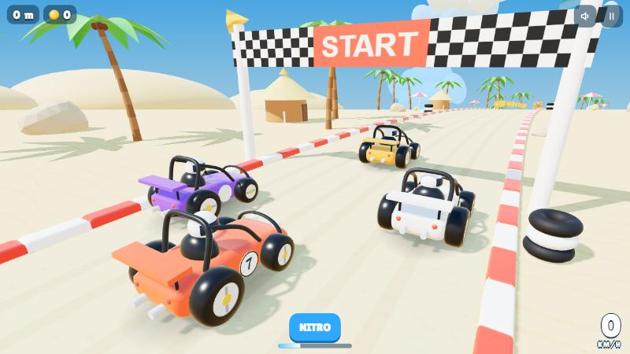

Race a rounded, glossy buggy down a winding sandy track lined with palms, beach huts and the sea. Dodge rival buggies and crates, grab coins to fill your nitro, hit blue pads for a boost, and launch off ramps for air time.

## Controls
| | Phone | Keyboard |
|---|---|---|
| Steer | Tilt the phone, or hold the left/right side of the screen | ← → or A / D |
| Nitro | Hold NITRO | Space or ↑ |
| Pause | Pause button (also re-centres tilt) | Esc or P |

## Scoring
- Distance earns points, and a close-call combo multiplies them
- Each coin is worth 25 points and fills nitro
- Close calls (passing a rival within 1 m) score 100 × combo
- Air time scores 200 points per second

## Scenes
| | | | |
|---|---|---|---|
| 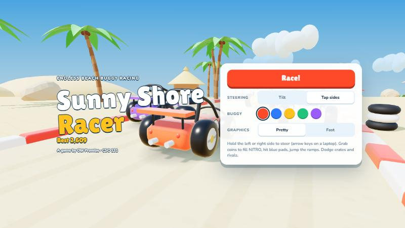 | 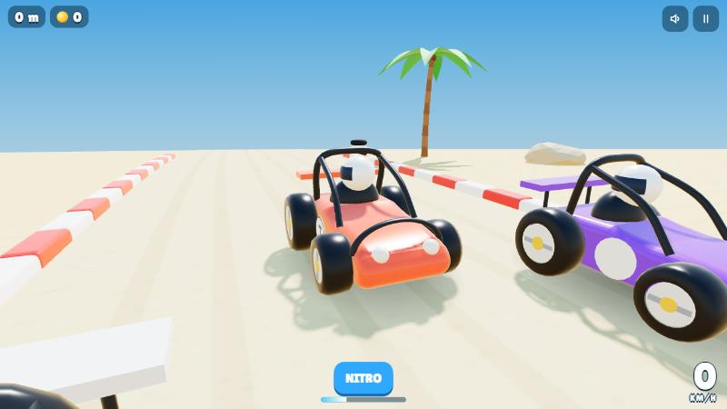 | 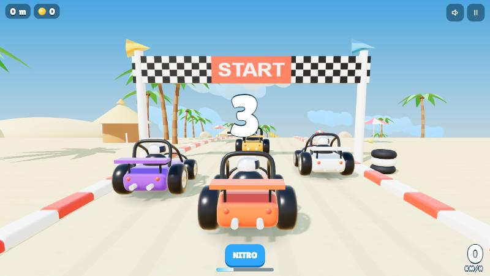 | 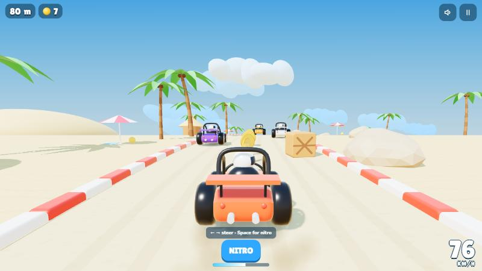 |
| 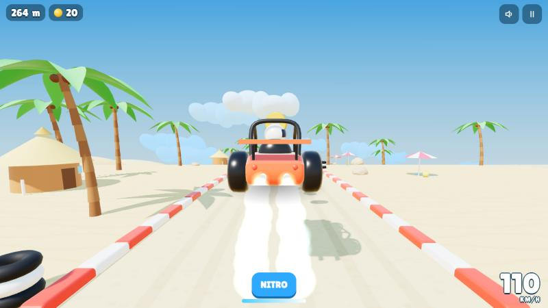 | 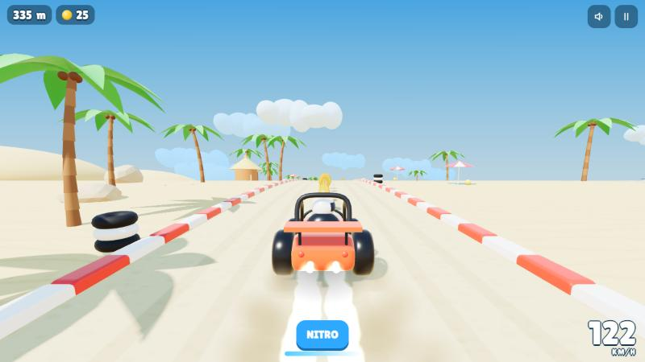 | 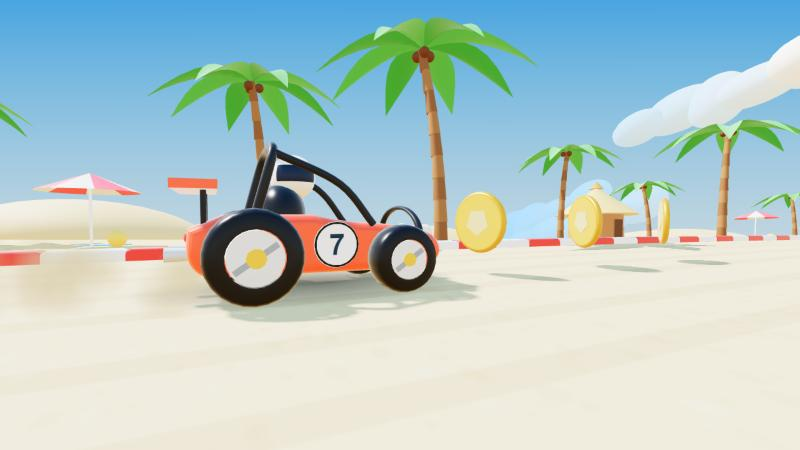 | 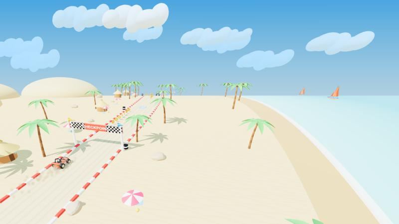 |
| 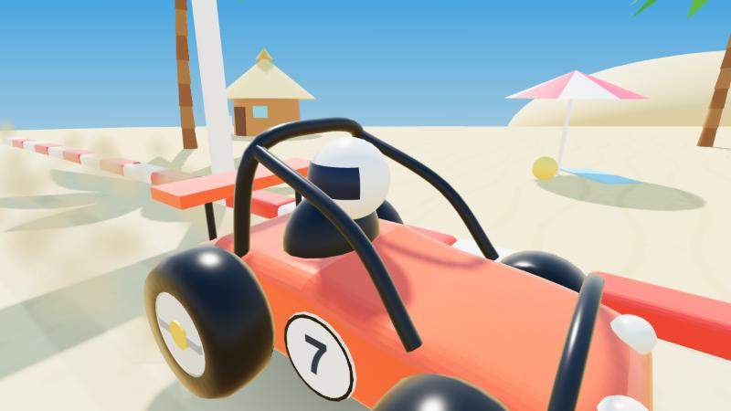 | 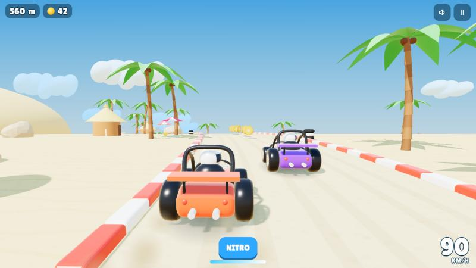 | 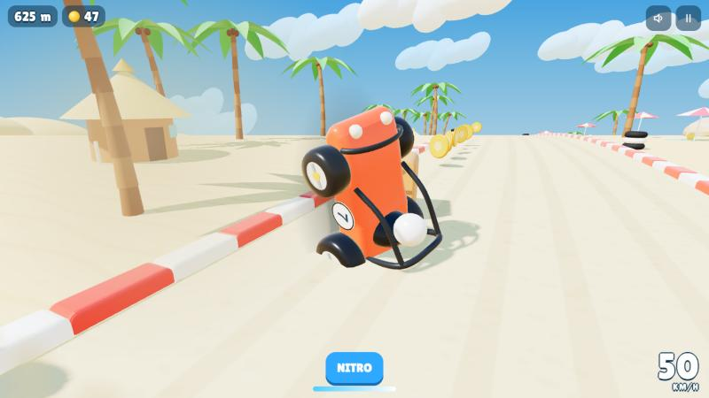 | 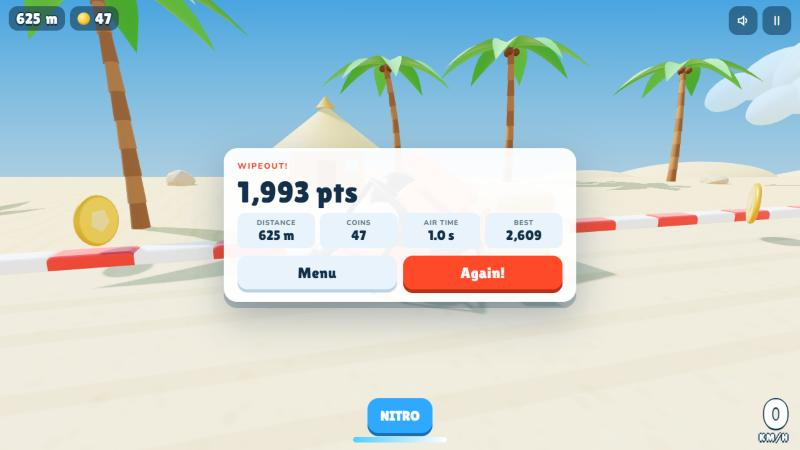 |

## How it works
One HTML file using JavaScript and Three.js.
- The buggy stays at z = 0 and the world scrolls past it. A small **vertex-shader bend** curves everything left and right and over the horizon, so a straight road looks like it winds.
- Every prop (palms, huts, umbrellas, rocks, boats, kerbs) is built from simple shapes, its colours are baked in, and the parts are **merged into one mesh**. Each prop type is then drawn **instanced** in a single draw call.
- Real-time soft shadows come from one sun light whose shadow box follows the buggy, ACES tone mapping and sky reflections on the paint.
- There are camera cut scenes: an opening fly-around and countdown, and a slow-motion crash orbit.
- It runs at up to 60 fps on phones, with a "Fast" graphics mode that lowers resolution and shadow quality.
